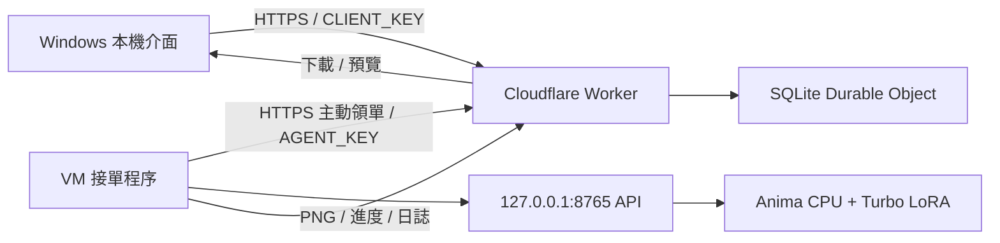

# Anima VM Studio

在 Codex 雲端 VM 以 CPU 執行 **Anima Base v1.0 + Turbo LoRA v0.2**，透過 Cloudflare HTTPS 中繼接收圖片任務；Windows 客戶端可送單、查看真實進度、預覽歷史圖片及下載結果。

本儲存庫只保存程式、測試與文件，**不包含 API 金鑰、OAuth 資料、模型權重、個人任務或私人圖片**。公開原始碼不代表 API 可匿名使用。

> VM 是暫時開發環境，平台可隨時暫停或重建。這不是常開主機，客戶端不能喚醒它。沒有啟用付費模型 API 或付費雲端主機；Cloudflare 帳號須維持 Workers Free。免費方案有額度與限制。

## 教程入口

- **[Windows 完整操作教程](docs/WINDOWS_GUIDE.md)**：已有安裝改用 Git、首次安裝、更新、操作、錯誤排除。
- **[VM 建置與恢復教程](docs/VM_GUIDE.md)**：安裝模型、啟動、加密配對、恢復、檢查與故障處理。
- [歷史單與快取](docs/HISTORY_PREVIEWS.md)、[尺寸與進度](docs/RESOLUTION_PROGRESS_UPDATE.md)。
- [Cloudflare 中繼技術說明](relay/README.md)、[模型授權](docs/MODEL_LICENSE.md)。

## 已有安裝：改成 Git 更新

在 **Windows 電腦**安裝 Git、Node.js 22+；Python 3.10+ 供客戶端使用。先在 PowerShell 執行一次：

```powershell
git clone --branch work/anima-restore https://github.com/s9213712/codex_VM_anima.git D:\AnimaSource
```

往後關閉舊客戶端，雙擊 `D:\AnimaSource\Update-From-Git.bat`：

1. 從核對過的 GitHub origin 拉取 `work/anima-restore`，只允許 fast-forward。
2. 第一次選原本含 `.private` 的 **應用程式安裝資料夾**，例如 `D:\anima-cloudflare-windows\anima-cloudflare`。與 Git 原始碼資料夾分開。
3. 程式直接更新客戶端與既有 `anima` Worker，不重填設定、不重複確認一般更新選項；帳號須繼續維持 Free。
4. 沿用 Cloudflare 登入，例行更新不開啟登入；若憑證失效則停止，由你另行修復登入。
5. 更新成功後，雙擊應用程式資料夾的 `anima-client\start-windows.bat`。

更新工具保存金鑰、連線設定、圖片歷史及本機備份；不重啟 VM、不重送任務、不合併 main、不升級付費方案。Git checkout 若有修改或分岔會停止，**不會強制 reset**。Git 更新成功與 Cloudflare 部署成功是兩件事，請以最後的 DONE 與驗證結果為準。

公開 repo 的唯讀下載不需要 GitHub Token；Git 直接取得公開來源，不需要 GitHub CLI 或 GitHub 登入。日後改成私人 repo 時，先用自己的憑證管理器或官方 gh 完成一次登入；更新器只使用已保存憑證，失效時停止，不會偷偷發起新登入。

## 功能

| 功能 | 說明 |
|---|---|
| 模型 | Base v1.0；指定 Turbo v0.2，強度 1、CFG 1、Euler，預設 8 步 |
| 尺寸 | 寬高分別 128–1024，32 的倍數；1–20 步 |
| 任務 | 真實 CPU 推理，非同步排隊、檢查 SHA256、PNG 下載 |
| 進度與日誌 | 真實 scheduler 步數、階段、耗時、每單原始日誌尾端 |
| 資源圖表 | CPU、記憶體、磁碟快照折線圖；離線處不補造資料 |
| 歷史 | 雲端保留約 24 小時；本機紀錄、縮圖、搜尋、帶回參數 |
| 更新 | Git 拉取、固定 payload 校驗、應用檔案備份與本機回復 |
| 認證 | CLIENT_KEY 與 AGENT_KEY 分離；本機 UI 有 Host/Origin/session 檢查 |

前台用中文欄位、卡片及圖片顯示資訊，不把 API JSON 原始回應當使用介面。JSON 僅用於內部 API、設定與開發證據。匯出參數為一般文字。

## 運作方式



這是固定格式的圖片任務中繼，不是任意 URL、SSH 或 shell 代理。GitHub 只保存與更新程式；目前正常生圖任務走 Cloudflare，不需要 GitHub Issue 或 Actions。

## 目錄

| 路徑 | 用途 |
|---|---|
| `anima_api/` | VM API、SQLite 佇列、模型程序、資源量測 |
| `relay/` | Cloudflare Worker、接單 Agent、本機整合測試 |
| `client/` | 客戶端、UI、圖片與歷史快取；來源設定不含金鑰 |
| `windows-relay/` | Windows 首次 Cloudflare 部署資產 |
| `updater/` | 更新程式與經雜湊核對的應用 payload |
| `scripts/` | 安裝、Git 更新、模型下載及檢查工具 |
| `tests/`、`docs/` | 測試、教程與明確標示的歷史實測證據 |
| `github_queue/` | 先前的可選私人 GitHub 收件匣；正常模式不使用 |

## VM 快速啟動

Linux x86_64、Python 3.12、uv、curl、flock，需模型下載網路權限及足夠磁碟/RAM：

```bash
bash scripts/install.sh
bash scripts/start.sh
```

另開 VM 終端，安全配對完成後：

```bash
export ANIMA_RELAY_URL='https://你的實際Worker網址'
export ANIMA_RELAY_AGENT_KEY_FILE='/workspace/anima-server/.state/relay-agent.key'
.venv/bin/python relay/agent.py
```

不要把金鑰放在參數、URL、提示詞或 Git。完整部署與配對請看教程；單跑上述程式不會自動取得 Cloudflare 憑證。

## 限制與已知行為

- 只有 CPU；大尺寸可能很慢。單張推理不設固定時間上限，但 VM 平台可停止它，程序仍有 12GiB RSS 限制。
- API 僅綁 localhost。佇列最多 2 筆；開發 DB 最多 20 筆任務，達上限需人工檢視，不自動刪庫。
- Cloudflare 每 UTC 日最多 20 單；每張 PNG 最大 2MiB；約 24 小時到期，在下次請求清理。失聯租約會失效；活躍 Agent 透過進度續租。
- 本機最多保存 1000 筆紀錄、顯示最近 200 筆、圖片快取 100MiB，達上限不自動刪舊圖。
- CFG 1 下負面提示詞不參與引導。去噪 100% 不代表解碼與儲存完成。
- VM 磁碟及 `.state` 不保證跨重建保存。Cloudflare API 及公開原始碼無法喚醒 VM。
- Windows 更新器與部署仍需使用者帳號操作；本專案不宣稱有 Windows 實機自動化驗收或全天候在線保證。

## 測試與開發

```bash
.venv/bin/python -m pytest -q
(cd relay && npm ci --ignore-scripts && npm test)
node --test updater/update.test.cjs
python scripts/build-updater.py
```

修改 `client/` 或 `relay/` 後，務必重新建置 payload、跑測試，再提交工作分支。否則 Git 原始碼與安裝版本可能不同。

截至 2026-11-23：21 項 Python、8 項 Miniflare 與更新器備份/回復測試通過。真實模型驗證另記於 `docs/evidence/`：768×512 單步、Turbo 256×256 八步約 74 秒。這些是指定當次量測，不能當作所有任務的速度保證；1024 大圖沒有固定完成時間承諾。

## 資安與授權

絕不提交 `.private/`、`.state/`、`.env`、OAuth 設定、模型權重、資料庫或個人圖片。請自行保護應用程式資料夾及本機備份。模型與 LoRA 使用各自授權，GitHub 原始碼公開不改變模型授權條件。
